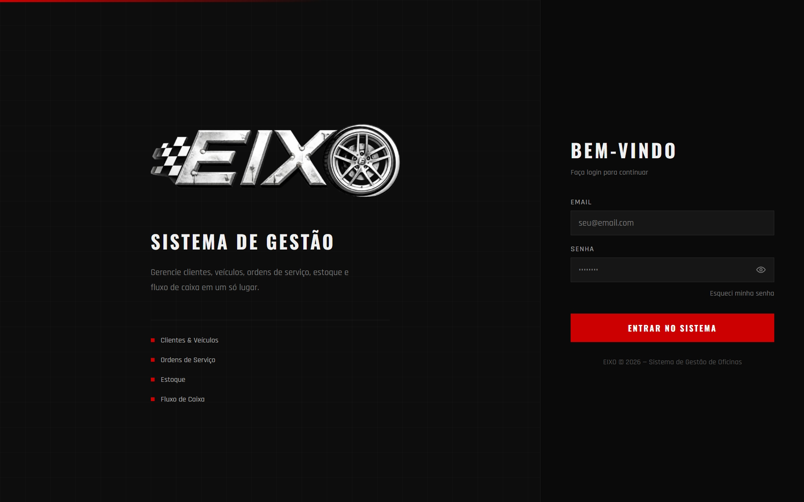
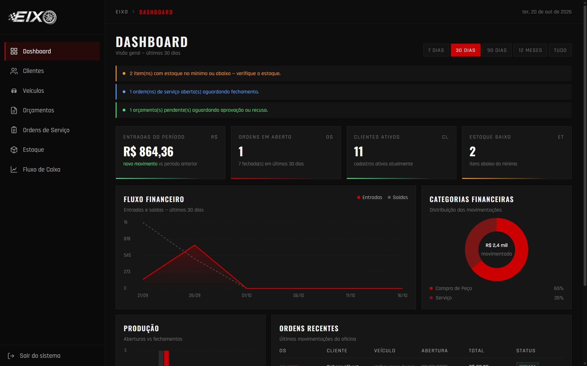
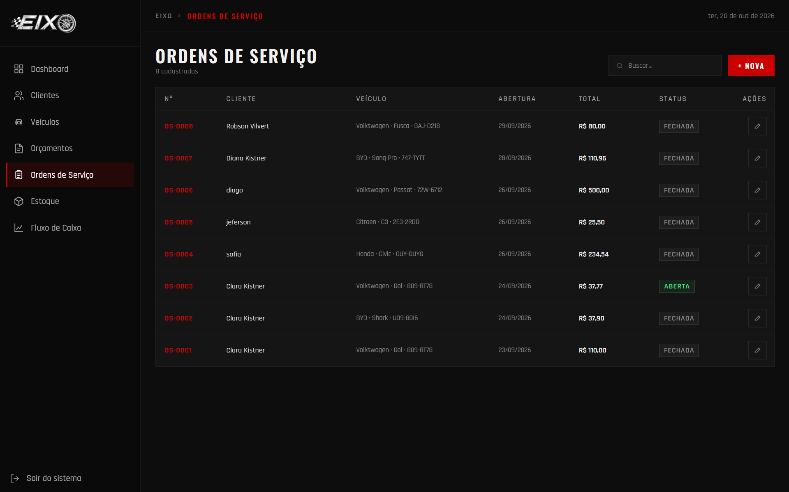
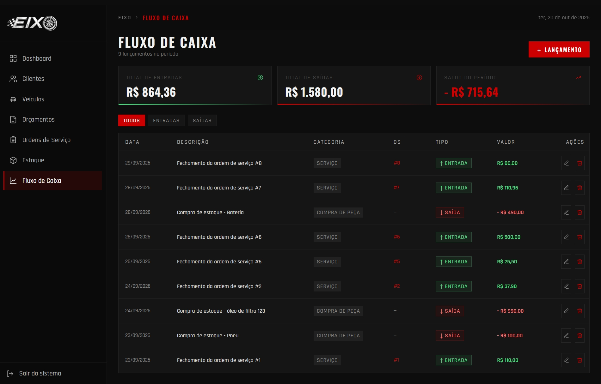

# Eixo · Frontend

Interface web do **Eixo**, sistema de gestão para oficinas mecânicas desenvolvido como projeto de conclusão do curso **Entra21 – Java** e apresentado na **OktoberTech 2026**.

O frontend foi construído com **HTML, CSS e JavaScript puro**, sem frameworks, e consome a API REST do backend em Spring Boot.

> Backend: [Eixo_backend](https://github.com/vinipxg06-pixel/Eixo_backend)

<p align="left">
  
  
  
</p>

## Sumário
- [Telas](#telas)
- [Tecnologias](#tecnologias)
- [Estrutura de pastas](#estrutura-de-pastas)
- [Equipe](#equipe)

## Telas
| Tela | O que faz |
| --- | --- |
| **Login** | Autenticação do usuário e redirecionamento para o dashboard |
| **Dashboard** | Indicadores da oficina (receita, OS abertas, clientes, itens com estoque baixo), gráfico de fluxo financeiro, gráfico de categorias, produção e ordens recentes |
| **Clientes** | Listagem com busca, cadastro e edição |
| **Veículos** | Cadastro vinculado ao cliente, com seleção de marca e modelo |
| **Orçamentos** | Criação de orçamento com peças do estoque, aprovação (gera a OS) e recusa |
| **Ordens de Serviço** | Abertura de OS, inclusão de peças, mão de obra e fechamento |
| **Estoque** | Cadastro de peças e registro de entradas e saídas |
| **Fluxo de Caixa** | Lançamentos de entrada e saída, com filtro por tipo |

### Login


### Dashboard


### Ordens de Serviço


### Fluxo de Caixa


## Tecnologias
- **HTML5** e **CSS3**: layout responsivo com menu lateral recolhível em telas menores
- **JavaScript (ES6+)**: manipulação do DOM e consumo da API com **Fetch API** e `async/await`
- **Gráficos do dashboard** feitos do zero, sem bibliotecas externas
- **localStorage** para manter os dados da sessão (usuário e oficina)

## Estrutura de pastas
Cada tela tem a própria pasta com HTML, CSS e JS. O que é compartilhado fica em `global/`.

```
Eixo_frontend/
├── assets/images/      # Logos e ícones
├── global/
│   ├── css/            # Estilos globais, menu e notificações (toast)
│   └── js/
│       ├── config.js       # URL da API
│       ├── api.js          # Função central de requisições (fetch + tratamento de erros)
│       ├── session.js      # Sessão do usuário no localStorage
│       ├── layout.js       # Cabeçalho das páginas
│       ├── menu.js         # Menu lateral e logout
│       ├── formatters.js   # Máscaras e formatação (CPF/CNPJ, telefone, moeda etc.)
│       └── toast.js        # Notificações na tela
├── login/
├── dashboard/
├── clientes/
├── veiculos/
├── orcamentos/
├── ordens-servico/
├── estoque/
└── fluxo-caixa/
```

## Equipe
- [Bárbara Fabiana de Souza](https://github.com/Barbara-fs)
- [Clara Bianca Kistner](https://github.com/clarakistner)
- [Luiz Filipe Reis](https://github.com/ldzinl)
- [Luiz Henrique Testoni](https://github.com/luiztestonidev)
- [Vinicius dos Santos Soares](https://github.com/vinipxg06-pixel)
